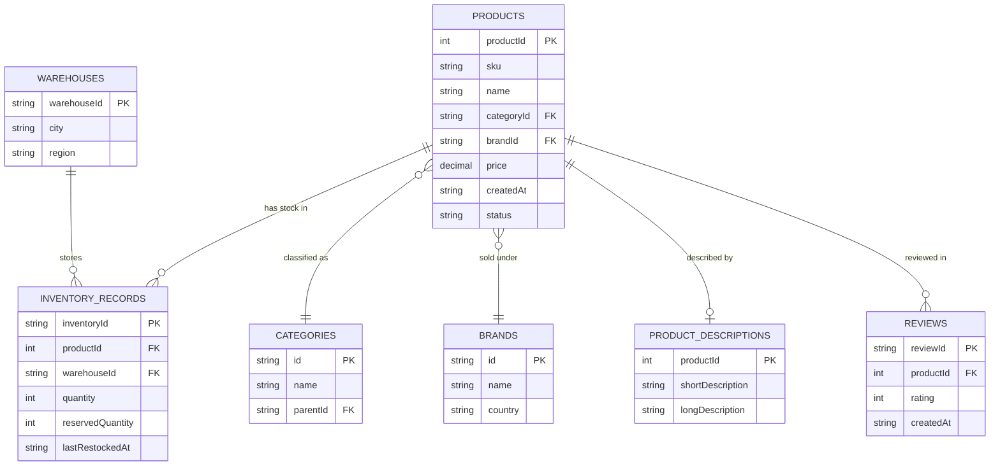

# Data Architecture

This document explains how the six raw sources become a searchable catalogue. It describes the intended pipeline, the join and aggregation rules, and the trade-offs behind them. It is a reference for the challenges, not a solution to them: later days ask you to implement and improve parts of this design.

---

## 1. Source systems

The bootcamp simulates a marketplace where each system is owned by a different team and has its own export conventions.



| Source | Owner (simulated) | Cardinality relative to a product | Referential integrity |
| --- | --- | --- | --- |
| `products.csv` | PIM | 1 | Primary source of truth for ids |
| `categories.json` | Category service | 0..1 | **Broken by design** (90 products) |
| `brands.json` | Supplier catalogue | 0..1 | **Broken by design** (74 products) |
| `product-descriptions.json` | CMS | 0..1 | Valid, but optional (28% missing) |
| `inventory.json` | WMS sync | 0..N (usually 1–4) | Valid, but duplicates exist |
| `reviews.json` | Reviews platform | 0..N | **Broken by design** (120 orphans) |

---

## 2. Target model

The search engine consumes a normalised product, not the raw rows:

```ts
interface NormalisedProduct {
  id: number;
  sku: string;
  name: string;
  nameNormalised: string;      // lower-cased, trimmed, used for matching
  categoryId: string | null;   // null when missing or unknown
  categoryPath: string[];      // e.g. ["Electronics", "Audio"]
  brandId: string | null;
  brandName: string | null;
  description: string;         // "" when absent
  features: string[];
  price: number;               // kept as received, anomalies included
  currency: 'USD';
  status: 'active' | 'discontinued' | 'draft';
  stock: {
    totalQuantity: number;
    availableQuantity: number; // totalQuantity - reservedQuantity
    warehouses: number;
  };
  inStock: boolean;
  rating: {
    average: number | null;    // null when there is no valid rating
    count: number;
    reviewCount: number;       // includes reviews with null ratings
  };
  createdAt: string;           // normalised ISO date where parseable
  dataQuality: string[];       // e.g. ["unknown-category", "duplicate-inventory"]
}
```

The exact shape is yours to refine on Day 04. What matters is that each field has a documented source and a rule for missing values.

---

## 3. Pipeline stages

```text
raw files
   │
   ├─ 1. Read          parse CSV (RFC 4180) / JSON, no silent coercion
   │
   ├─ 2. Normalise     trim strings, unify casing, parse dates where needed
   │
   ├─ 3. Resolve refs  join categories, brands, descriptions, inventory, reviews
   │
   ├─ 4. Aggregate     stock across warehouses; ratings ignoring nulls
   │
   ├─ 5. Validate      invariants + data-quality flags
   │
   └─ 6. Index         token → product ids (Day 05)
            │
            └─ 7. Query  filter → rank → sort → paginate
```

### Stage rules that must be explicit

| Stage | Rule | Why |
| --- | --- | --- |
| Read | Quote-aware CSV parsing; never `split(',')` | Names contain commas and untrimmed whitespace |
| Normalise | Trim names; lower-case only for matching, not display | Display should keep `Café` and `BERGSTRÖM` |
| Resolve | Category/brand joins are **left** joins | A missing category must not drop the product |
| Resolve | Description join is optional | 28% of products have no CMS record |
| Aggregate | Stock = sum of `quantity` over all rows | Matches the WMS export semantics |
| Aggregate | Rating = mean of non-null ratings | 282 reviews have `rating: null` |
| Aggregate | Orphan reviews are excluded from product aggregates | 120 reference unknown products |
| Validate | Never throw on documented data issues | Only structural corruption should fail a build |

---

## 4. Join and aggregation decisions

### 4.1 Category and brand (left joins with explicit nulls)

Ninety products have an empty or unknown `categoryId`; seventy-four have a missing or unknown `brandId`. Dropping them would silently shrink the catalogue by roughly 1.7% and break search parity tests. The pipeline keeps them, sets the resolved id to `null`, and records a data-quality flag. Presentation can then show "Uncategorised" without lying about the id.

The category hierarchy matters for filtering: filtering by a root should include leaf categories. Resolving the path at load time (`["Electronics", "Computers"]`) keeps the query layer simple.

### 4.2 Inventory (one-to-many with duplicates)

A product has zero to four warehouse rows — or no rows at all, which also means zero stock. Duplicate `(productId, warehouseId)` pairs represent conflicting sync writes.

There is no universally "correct" resolution. Reasonable options:

1. **Sum all rows.** Simple, matches "total units on hand", but double-counts a duplicated row.
2. **Take the row with the latest `lastRestockedAt`.** Closest to a snapshot, but mixed date formats complicate parsing.
3. **Deduplicate by pair and keep the maximum.** Conservative for availability, arbitrary for totals.

Whichever you choose, document it and apply it in one place. The provided Day 01 loader uses option 1 for simplicity; Day 04 is where you revisit the decision.

### 4.3 Reviews (nullable, uneven, partly orphaned)

Reviews are sparse: 865 products have none, and a few have dozens. Any average must handle the empty set — `null` is honest, `0` is a lie that will rank unreviewed products last for the wrong reason. Orphan reviews must never be attributed to a product.

Review counts and average ratings are also unstable signals on a small number of reviews. That is a ranking concern for Day 02, not a data-loading concern.

### 4.4 Price and dates

Prices are kept exactly as received, including `0`, negative values and six-figure anomalies. Filtering and sorting must define how to treat them; the loader must not decide on the user's behalf.

Dates appear in three shapes across sources (`YYYY-MM-DD`, ISO timestamps, `MM/DD/YYYY` or `DD/MM/YYYY`). Parsing ambiguity is unavoidable for the slashed format. Pick a documented policy, keep the original string, and never let an unparseable date throw.

---

## 5. Data flow through the week

| Day | What changes in the pipeline | New source of truth |
| --- | --- | --- |
| 01 | Provided loader produces the minimum `Product` | Catalogue + categories + descriptions + inventory |
| 02 | Ranking metadata (rating, review count) is added | + brands, reviews |
| 03 | Filters read from the normalised model | Full model |
| 04 | You own the pipeline; model expands and is validated | All six sources |
| 05 | Index is built from the normalised model | Derived artefact |
| 06 | Pagination and caching wrap the query layer | Derived artefact |
| 07 | Modules are assembled behind a facade | Everything |

---

## 6. Performance considerations

With 5,200 products, a linear scan plus token checks is fast enough (single-digit milliseconds in Node). The dataset is deliberately large enough that naive per-request work becomes visible when you:

- re-read and re-parse roughly 8 MB of JSON on every keystroke;
- rebuild the index on every query;
- sort the whole catalogue before filtering;
- aggregate reviews for products that were filtered out;
- stringify the full result set before pagination.

Two principles cover most of it:

1. **Do expensive work once.** Parse and normalise at startup or behind a cache; rebuild only when the catalogue changes.
2. **Push work to the narrowest stage.** Filter before ranking, rank before pagination, and paginate before serialisation.

Day 06 formalises this with measurements. Until then, prefer the simplest correct implementation and note where you *would* optimise.

### Memory

The raw files total roughly 8 MB on disk, but the in-memory model is larger (objects, maps, index postings). A `Map<string, Set<number>>` index over 5,200 names is still small; the same index over 500,000 names is not. State your assumptions when discussing scale.

---

## 7. Failure modes to design for

| Failure | Symptom | Mitigation |
| --- | --- | --- |
| Naive CSV splitting | Misaligned columns, corrupted names | Quote-aware parser |
| Assuming every reference is valid | Missing products after joins | Left joins + null handling |
| Averaging null ratings as zero | Wrong ranking | Explicit null semantics |
| Deduplicating inventory incorrectly | Wrong `inStock` | Documented aggregation rule |
| Sorting before filtering | Wasted work, unstable order | Stage ordering |
| Sorting only by score | Non-deterministic pages | Stable tie-breaker |
| Recomputed index per query | Latency spikes | Build once, cache, invalidate |
| Silent date parsing failure | `NaN` dates in output | Validate, keep raw string |

---

## 8. What "good" looks like

- A reader can trace every field of the normalised model back to a raw source and a rule.
- Data-quality issues are surfaced, not hidden.
- Each stage is a pure-ish function that can be tested with small fixtures.
- The query layer does not know how files are parsed; the loader does not know how ranking works.
- Complexity and memory are stated with variables and measured, not guessed.

That is the architecture the interview will probe.
